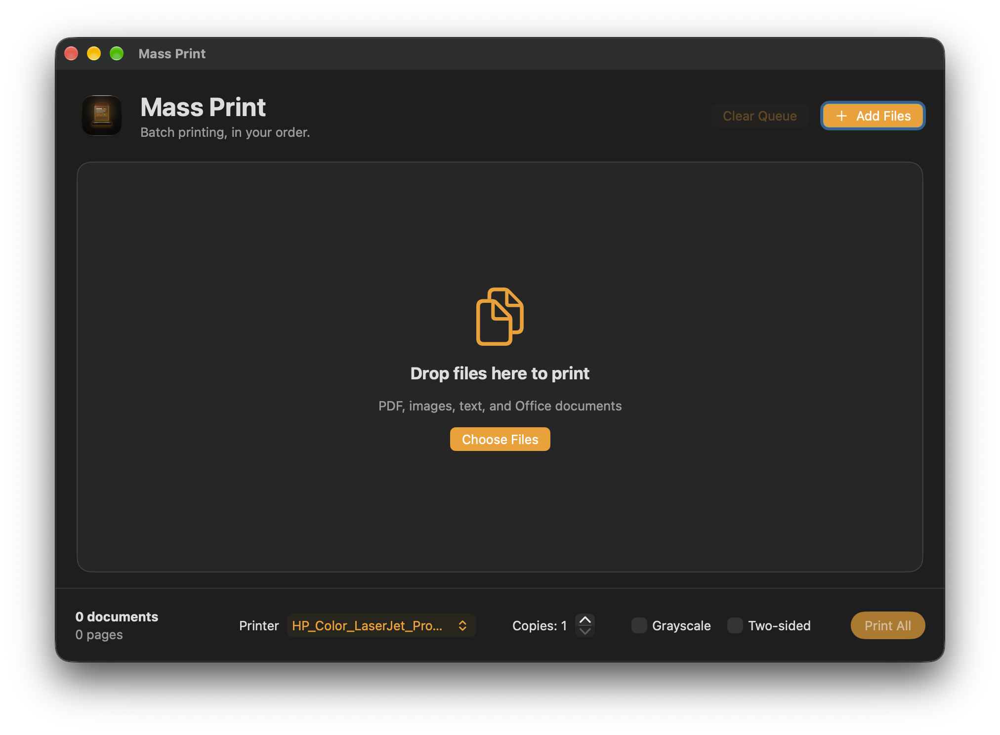
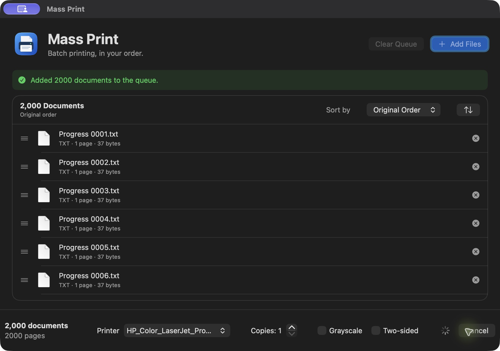
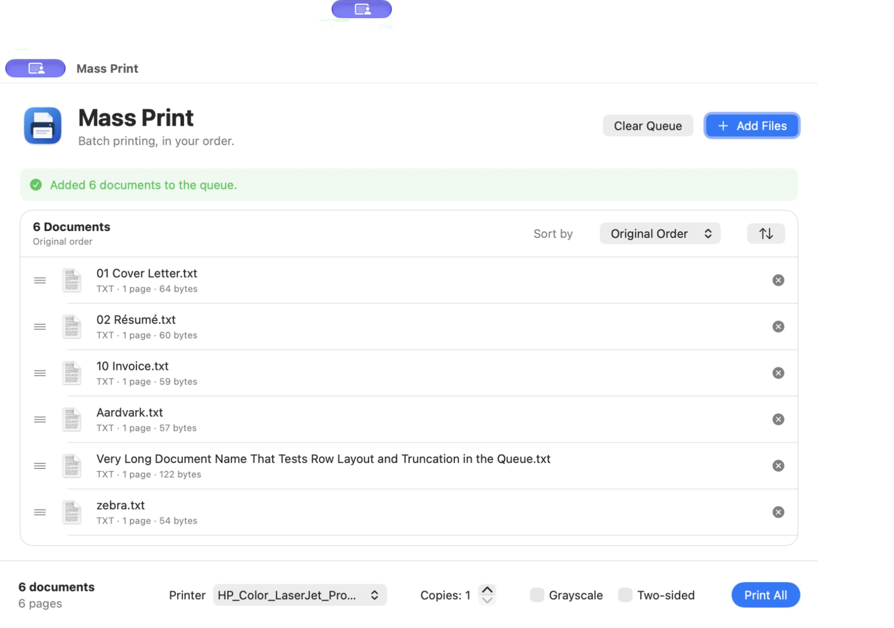
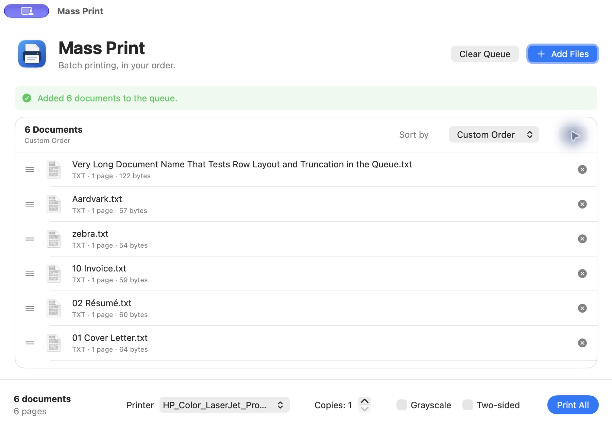
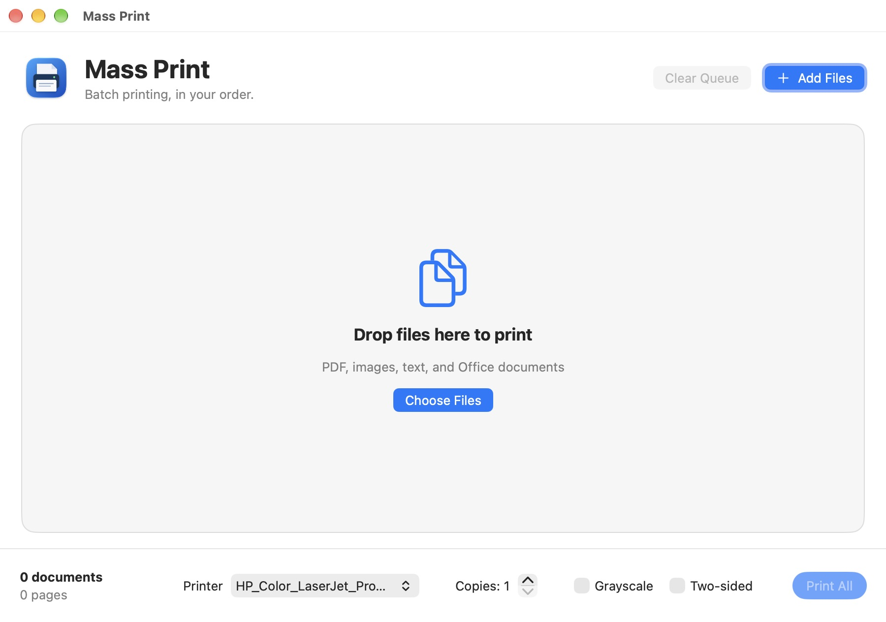
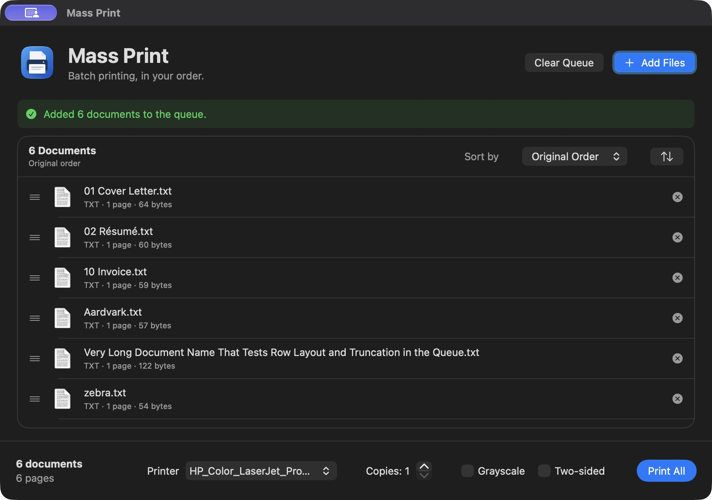

# Mass Print

<p align="center">
  
</p>

<p align="center">
  <b>A native macOS batch-printing utility engineered with SwiftUI, AppKit, and an auditable Rust printing core.</b><br>
  Strict document ordering, drag-and-drop queue management, Finder integration, and CUPS safety controls.
</p>

<p align="center">
  <a href="https://github.com/gobelet69/Mass-Print/releases/latest"></a>
  
  
  
  
  
  
</p>

---

## 1. Overview

**Mass Print** is a dedicated batch-printing utility for macOS power users, administrators, and studios that regularly print multi-file document sets. While standard macOS printing requires opening and configuring documents one by one, Mass Print consolidates diverse files into a single, strictly ordered queue with drag-and-drop reordering, natural sorting, and sequential submission to the macOS CUPS print spooler.

The graphical interface is built natively in **SwiftUI and AppKit**, with zero WebView or Tauri overhead. The underlying queue state machine, file conversion logic, document metadata extraction, and spooler coordination run in a deterministic, tested **Rust core** (`mass-print-core`).

---

## 2. Genuine Application Screenshots

| Primary Queue Window (Light) | Batch Preparation (Dark) |
|:---:|:---:|
|  |  |

| Multiple Document Ingestion | Drag-and-Drop Reordering |
|:---:|:---:|
|  |  |

| Empty State (Light) | Dark Appearance Mode |
|:---:|:---:|
|  |  |

---

## 3. Main Features

- **Strict Document Order Preservation**: Documents print in the exact sequence displayed in the queue. The Rust core maintains stable document UUIDs and a single source of truth, guaranteeing that visual reordering cannot diverge from spooler submission.
- **Natural Sorting Engine**: One-click sorting by natural filename (handling numeric chapters and accents intelligently), file size, modification date, page count, file format, or original insertion order.
- **Native Finder Integration**: Adds a native system service (**Print with Mass Print**) accessible via right-click contextual menus and the Services / Quick Actions menu in Finder. Selected documents are queued immediately without opening separate viewers.
- **Broad Document Compatibility**: Direct native support for PDF, plain text, rich text (RTF/RTFD), HTML, and raster images (PNG, JPEG, TIFF). Microsoft Office (`.docx`, `.xlsx`, `.pptx`) and OpenDocument (`.odt`, `.ods`, `.odp`) files are converted automatically via local LibreOffice without cloud telemetry.
- **Granular Print Controls**: Independent controls for copy count, duplex (double-sided) orientation, grayscale or colour reproduction, landscape or portrait layout, and fit-to-page scaling.
- **Safety and Isolation**: Mass Print never modifies your original files. Pre-flight checks verify that files are readable, uncorrupted, and properly parsed before submission to CUPS.

---

## 4. System Requirements

- **Operating System**: macOS 13.0 (Ventura) or later (fully supported on macOS 14 Sonoma and macOS 15+).
- **Architecture**: Universal 2 binary natively supporting both **Apple Silicon** (`arm64`) and **Intel** (`x86_64`).
- **Dependencies**: 
  - Standard macOS CUPS print subsystem (built into macOS).
  - Optional: [LibreOffice](https://www.libreoffice.org/) installed in `/Applications` (only required if batch-printing Microsoft Office or OpenDocument formats).

---

## 5. Installation Instructions

1. Download the latest Universal DMG from the **[GitHub Releases](https://github.com/gobelet69/Mass-Print/releases/latest)** page:
   - `Mass-Print-v0.2.1-macOS-universal.dmg`
2. Open the downloaded `.dmg` disk image.
3. Drag **Mass Print.app** into your `/Applications` directory.
4. Launch **Mass Print.app** once. On first launch, macOS Launch Services registers the native **Print with Mass Print** Finder service.
5. *Gatekeeper verification*: If using an ad-hoc or community build without Developer ID notarisation, right-click `Mass Print.app` in Finder, choose **Open**, and confirm.

---

## 6. Getting Started

1. **Launch Mass Print**: Open the app from Spotlight or `/Applications`. The queue window appears with the iridescent Amber theme.
2. **Add Files**:
   - Drag documents directly from Finder onto the Mass Print window.
   - Alternatively, click the **Add Files…** button (`Cmd + O`) or use the file picker.
   - Or select files in Finder, right-click, and choose **Services → Print with Mass Print**.
3. **Organise Your Queue**: Use the drag handles on the left of each row to manually adjust print sequence, or use the **Sort** menu for natural alphabetical or chronological sorting.
4. **Choose Printer & Settings**: Select your destination printer from the dropdown menu, configure duplex and copies, and verify page counts.
5. **Print**: Click the **Print Batch** button (`Cmd + P`). Mass Print spools each document sequentially and displays live progress.

---

## 7. Usage Instructions

### Finder Contextual Service
To queue files straight from the desktop or folder windows:
1. Select one or more documents in Finder.
2. Right-click and navigate to **Services → Print with Mass Print** (or find it in **Quick Actions**).
3. Mass Print activates and queues the documents in the order Finder delivered them.
4. *Safety guarantee*: Mass Print never begins printing automatically upon receiving files from Finder. You always retain visual review before spooling.

### Sorting Strategies
The sort bar above the queue provides:
- **Name (A–Z / Z–A)**: Human-natural alphanumeric sort (e.g. `Chapter 2.pdf` precedes `Chapter 10.pdf`).
- **Date Modified**: Order by creation or last edit timestamp.
- **Pages**: Sort by page count ascending or descending.
- **Size**: Sort by byte size on disk.
- **Reset**: Restores the original insertion order.

### Office & OpenDocument Conversion
When an Office (`.docx`, `.pptx`) or OpenDocument (`.odt`) file is imported:
- Mass Print verifies whether LibreOffice is present in `/Applications/LibreOffice.app`.
- If installed, a temporary, clean PDF is compiled in `/tmp` using headless LibreOffice.
- The compiled PDF is spooled to CUPS, and temporary files are cleaned up immediately. Your original document is untouched.

---

## 8. Keyboard Shortcuts

| Shortcut | Action |
|:---|:---|
| `Cmd + O` | Open File Dialog to Add Documents |
| `Cmd + P` | Submit Batch to Spooler |
| `Cmd + A` | Select All Documents in Queue |
| `Backspace` / `Delete` | Remove Selected Document(s) from Queue |
| `Cmd + K` | Clear Entire Queue |
| `Cmd + R` | Refresh Printer List and Status |
| `Cmd + W` | Close Window |
| `Cmd + Q` | Quit Mass Print |

---

## 9. Building from Source

### Prerequisites
- macOS 13.0 or later.
- Xcode Command Line Tools (`xcode-select --install`).
- [Rust](https://rustup.rs/) (1.85+ recommended).
- Universal compilation targets:
  ```bash
  rustup target add aarch64-apple-darwin x86_64-apple-darwin
  ```

### Build Steps

1. Clone the repository:
   ```bash
   git clone https://github.com/gobelet69/Mass-Print.git
   cd Mass-Print
   ```
2. Build the universal native application bundle:
   ```bash
   ./scripts/build-native-app.sh
   open "build/native/Mass Print.app"
   ```
3. Package the distributable Universal `.dmg`:
   ```bash
   ./scripts/package-native-release.sh
   ```
   The packaged artifacts appear in `dist-native/`.

> [!TIP]
> If building inside an iCloud Drive-synced directory (`~/Documents`), run with `CARGO_TARGET_DIR=/tmp/mass-print-target` to prevent iCloud file coordination locks from slowing compilation.

### Running Automated Tests

Run the complete Rust core and FFI test suite:
```bash
CARGO_INCREMENTAL=0 CARGO_TARGET_DIR=/tmp/mass-print-target cargo test --workspace
```
All 30 unit and integration tests execute in under 0.1 seconds.

---

## 10. Troubleshooting

- **The Finder Service does not appear in contextual menus**:
  Open Mass Print once to allow Launch Services to index the service. If it still does not appear, open **System Settings → Keyboard → Keyboard Shortcuts → Services → Files and Folders** and ensure **Print with Mass Print** is checked.
- **Office documents fail to queue**:
  Ensure LibreOffice is installed in `/Applications/LibreOffice.app`. Native PDFs and images do not require LibreOffice.
- **A print job stalled in the spooler**:
  Mass Print communicates directly with CUPS. You can inspect active system print queues in **System Settings → Printers & Scanners** or via your web browser at `http://localhost:631/jobs`.

---

## 11. Known Limitations

- **CUPS Spooler Requirement**: Mass Print requires an active CUPS daemon (standard across all macOS installations).
- **Protected PDF Passwords**: Encrypted PDFs requiring passwords must have security removed prior to batch submission.
- **Document Previews**: Mass Print displays document metadata and page counts rather than a full multi-page visual reader. For in-depth reading, use [Iridescence PDF Reader](https://111iridescence.org/apps/iridescence-pdf-reader).

---

## 12. Download and Releases

All official releases, Universal DMG packages, and cryptographic checksums are available on GitHub:
- **Latest Release**: [GitHub Releases](https://github.com/gobelet69/Mass-Print/releases)
- **Official Showcase**: [111iridescence.org/apps/mass-print](https://111iridescence.org/apps/mass-print)

Each release includes a verified Universal DMG and a `SHA256SUMS.txt` manifest.

---

## 13. Contributing

Contributions, bug reports, and enhancements are welcomed. Please check existing issues and open a discussion or pull request. Ensure that all tests pass (`cargo test --workspace`) and that the native Finder service integration remains validated.

---

## 14. Licence

This project is licensed under the **[MIT Licence](LICENSE)**.

---

## 15. Acknowledgements

- Built with Apple's native SwiftUI and AppKit user interface frameworks.
- Fast PDF inspection powered by the [`lopdf`](https://github.com/J-F-Liu/lopdf) Rust library.
- Developed by **[111iridescence](https://111iridescence.org)** with AI-assisted software systems engineering.
